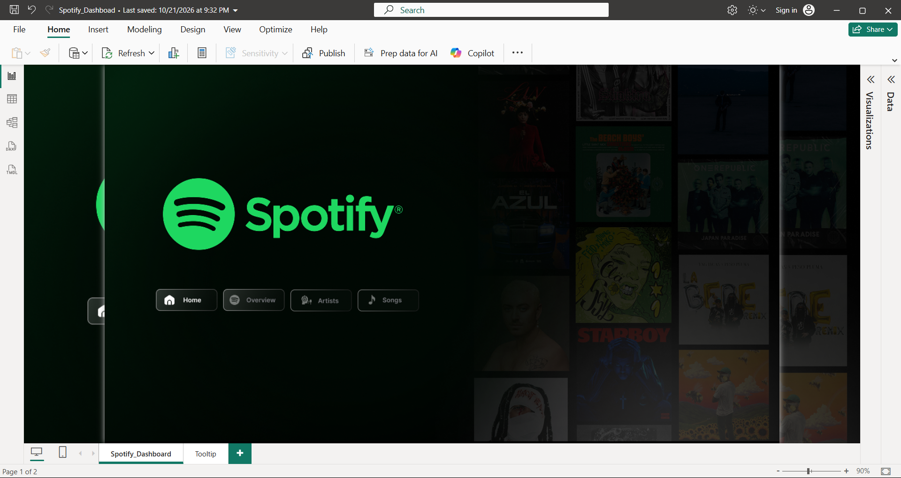
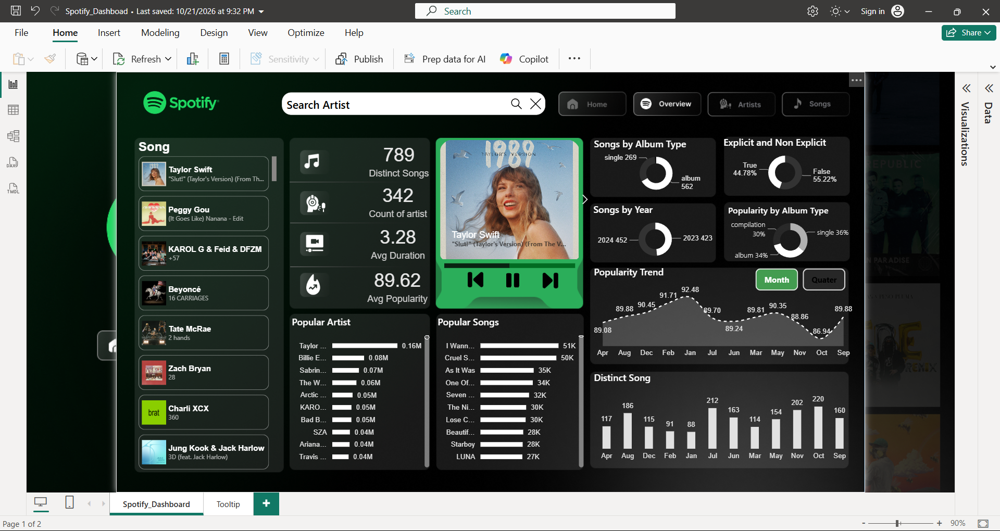
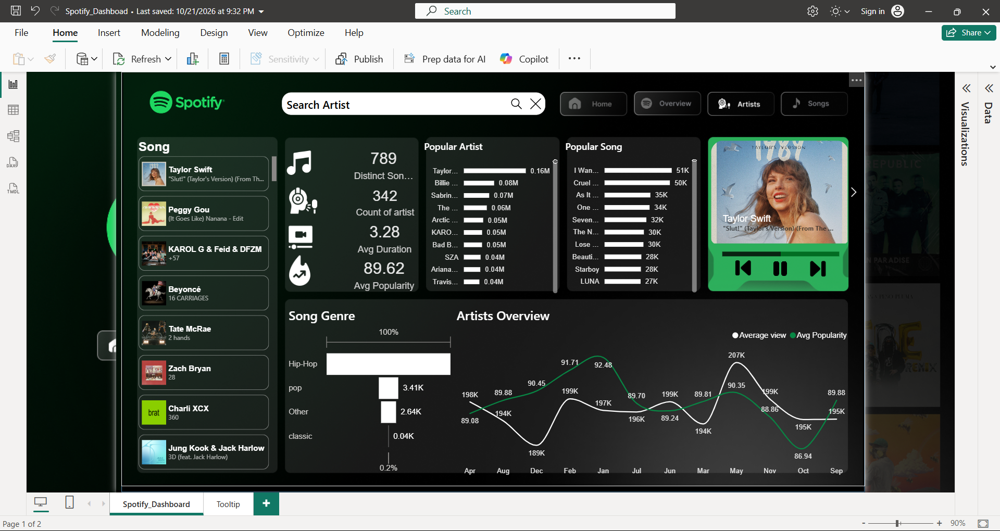
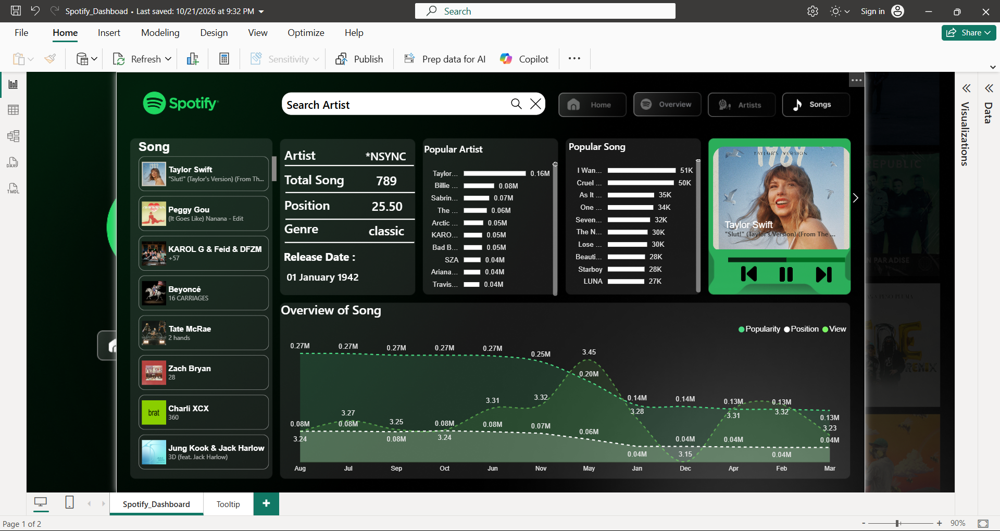

# 🎧 Spotify Analytics Dashboard (Power BI + Python)

An interactive, app-style Spotify dashboard built in Power BI. The raw dataset was cleaned with Python (Pandas) in Jupyter Notebook, then modeled with DAX and visualized in a single-page report that uses bookmarks, the Selection Pane, and a custom tooltip page to behave like a multi-page app.


## Overview
Explores streaming popularity, artist performance, genre mix, and release trends across **789 distinct songs from 342 artists**. Users can navigate between four views (Home, Overview, Artists, Songs), search for any artist, switch between monthly and quarterly trends, and hover over a song to see its full details.

## Objective
Turn a raw, messy music dataset into a clean, explorable dashboard that answers questions like:
- Which artists and songs are the most popular?
- How does popularity change over the year?
- What is the split between singles, albums, and compilations?
- How much of the catalog is explicit vs non-explicit?
- Which genres dominate the charts?

## Key Metrics
| Metric | Value |
|---|---|
| Distinct songs | 789 |
| Distinct artists | 342 |
| Average song duration | 3.28 min |
| Average popularity | 89.62 |

## Dashboard Pages
| Page | What it shows |
|---|---|
| **Home** | Landing screen with navigation buttons to every view |
| **Overview** | KPI cards, popular artists and songs, songs by album type, explicit vs non-explicit split, songs by year, popularity trend (month/quarter toggle), and distinct songs by month |
| **Artists** | Artist selector, popular artists, number of songs per artist, song genre breakdown, and an Artists Overview chart comparing average popularity with views |
| **Songs** | Song details panel (artist, total songs, position, genre, release date), popular songs, and an "Overview of Song" trend chart for popularity, position, and views |

| Home | Overview |
|---|---|
|  |   |

| City Performance | Home |
|---|---|
|  |  |

## Features
- **Single-page, app-style navigation**: bookmarks plus grouped show/hide visuals in the Selection Pane switch between Home, Overview, Artists, and Songs without extra report pages
- **Custom tooltip page**: hovering over a song shows its cover art, artist, song title, release date, position, genre, explicit flag, and popularity trend
- **Artist search box** for quickly finding any artist
- **Month / Quarter toggle** on the popularity trend
- **Music-player style card** with the featured album art
- **Cross-filtering**: selecting an artist or song updates the related visuals
- **Dark Spotify-inspired theme** with custom icons and buttons

## Tools Used
- Python, Pandas, NumPy, Jupyter Notebook (data cleaning)
- Power BI Desktop (data modeling and visualization)
- DAX (measures)
- Bookmarks, Selection Pane, Tooltip pages, Slicers

## Data Pipeline
```
Raw CSV  →  Pandas cleaning (Jupyter)  →  Cleaned CSV  →  Power BI (DAX + visuals)
```

## Data Cleaning Steps (Python / Pandas)
> Replace these with your actual steps and numbers from `notebooks/data_cleaning.ipynb`.

1. **Loaded and inspected** the raw dataset (`head()`, `info()`, `shape`, `isnull().sum()`)
2. **Handled missing values**: [describe, e.g. dropped / filled X nulls in columns ...]
3. **Removed duplicate rows**: [N] duplicates dropped
4. **Fixed data types**: [e.g. release date to datetime, duration to minutes]
5. **Standardized text columns** (artist names, genres, album type)
6. **Engineered new columns**: [e.g. Year, Month, Quarter, Explicit flag]
7. **Exported** the cleaned file to `data/cleaned/` for Power BI

## Key Insights
- **Taylor Swift** leads by a wide margin with 85 songs in the dataset, followed by Travis Scott (30) and Drake (27)
- The average popularity score is **89.62**, and the monthly trend stays within roughly **87 to 92**, so popularity is consistently high year-round
- **Albums account for about twice as many songs as singles** in the album-type breakdown
- **Hip-Hop** is the largest genre in the genre chart, followed by Pop
- Explicit tracks make up roughly **45%** of the dataset
- More songs fall in **2024 (452)** than **2023 (423)**

## Repository Structure
```
spotify-powerbi-dashboard/
├── Spotify_Dashboard.pbix
├── notebooks/
│   └── data_cleaning.ipynb
├── data/
│   ├── raw/
│   └── cleaned/
├── images/
└── README.md
```

## How to Use
1. Download `Spotify_Dashboard.pbix` and open it in **Power BI Desktop**
2. If Power BI asks for the data source, point it to `data/cleaned/` in your local copy
3. Use the **Home / Overview / Artists / Songs** buttons to navigate, and hover over a song to see the tooltip
4. To reproduce the cleaning, open `notebooks/data_cleaning.ipynb`, update the file path in the first `pd.read_csv(...)` cell, and run all cells top to bottom

## Possible Next Steps
- Publish the report to Power BI Service and add a live link
- Add a genre-level drill-through page
- Add a forecast for the popularity trend
- Add more years of data for deeper trend analysis

## Dataset Source
Raw dataset from Spotify_Noisy_Data.xls.

## Disclaimer
This is an independent portfolio project. Spotify, album art, and artist names belong to their respective owners and are used here for educational purposes only.

## Author
**Sidharth Arora**
[GitHub](https://github.com/SCArora03) | [LinkedIn](https://linkedin.com/in/sidharth-arora-6a12a2273)
